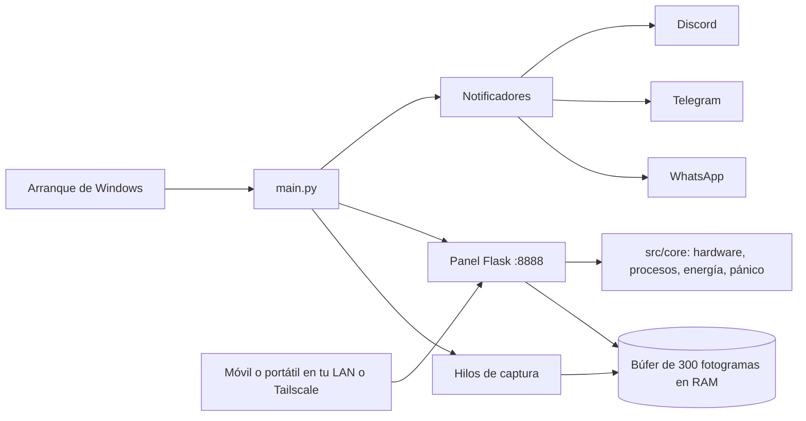

<div align="center">


**Aviso de arranque y panel de telemetría local para un PC con Windows.**

<em>Boot alerts and a local telemetry dashboard for a Windows PC.</em>

<br />

[Instalación](#instalación) · [Funciones](#funciones) · [Seguridad](#seguridad) · [Licencia](#licencia)

<br />

[](LICENSE)
[](https://www.python.org/)
[](https://flask.palletsprojects.com/)
[](#instalación)

</div>

---

## Qué es

OpenSentinel es una aplicación en Python que se ejecuta en tu propio PC con Windows. Al encender el equipo envía **un solo aviso por arranque** a Discord, Telegram o WhatsApp y levanta un **panel web local** (Flask, puerto 8888) para ver el estado del equipo y hacer acciones básicas desde otro dispositivo de tu red o por Tailscale.

No usa ningún servidor propio en la nube: los datos se quedan en tu PC salvo los avisos que tú decidas enviar a tus canales.

## Funciones

- **Aviso de arranque sin duplicados.** Guarda la marca de arranque en `boot_session.json` y solo avisa una vez por encendido (`--force-alert` lo fuerza).
- **Tres canales.** Webhook de Discord (con hilo opcional), bot de Telegram y WhatsApp vía CallMeBot o un webhook propio.
- **Panel local.** CPU, RAM, discos, ventana activa, lista de procesos y opción de cerrarlos.
- **Captura y webcam.** Captura de pantalla y foto de webcam bajo demanda (se pueden desactivar).
- **Búfer en memoria.** Guarda los últimos 300 fotogramas en RAM (unos 5 minutos) y los exporta a `evidencia_actual.mp4` cuando lo pides. Se pausa con juegos o programas pesados como Blender.
- **Botón de pánico.** Hace una foto con la webcam, silencia el audio y bloquea la sesión de Windows.
- **Energía.** Bloquear, suspender, apagar, reiniciar, cancelar, volumen y Wake-on-LAN.
- **Asistente de configuración.** `python main.py --setup` te guía por los canales y las opciones.
- **Idiomas.** Interfaz en español e inglés (`LANGUAGE`).

## Stack

| Parte | Tecnología |
|---|---|
| Servidor y panel | Python 3.10+, Flask, plantilla HTML única |
| Telemetría | psutil |
| Captura y vídeo | Pillow, OpenCV, NumPy |
| Avisos | requests (Discord, Telegram, WhatsApp) |
| Configuración | `config.json` o `.env` (python-dotenv) |
| Arranque automático | Acceso directo en la carpeta Inicio de Windows (`scripts/install.bat`) |
| Acceso remoto opcional | Tailscale o Caddy como proxy inverso |

## Arquitectura



## Seguridad

Léelo antes de instalarlo: el panel puede cerrar procesos, apagar el PC y ver la pantalla y la webcam.

- El panel **no tiene usuario ni contraseña**. Solo filtra por IP de origen: acepta `127.0.0.1`, `::1` y rangos que empiezan por `10.`, `192.168.`, `172.` y `100.` (Tailscale). Cualquiera en tu misma red local puede usarlo.
- No abras el puerto 8888 en el router. Para acceso remoto usa Tailscale.
- `ENABLE_WEBCAM`, `ENABLE_SCREENSHOT` y `ENABLE_CMD_EXECUTION` permiten desactivar las funciones más sensibles.
- `config.json` y `.env` contienen tokens de tus canales. Están en `.gitignore`; no los subas.
- Consulta [SECURITY.md](SECURITY.md) para reportar vulnerabilidades.

## Instalación

Requisitos: Windows 10 u 11 y Python 3.10 o superior.

```bash
git clone https://github.com/ATM-Software-Labs/open-sentinel.git
cd open-sentinel
pip install -r requirements.txt
python main.py --setup
python main.py
```

También puedes usar los scripts de `scripts/`:

| Script | Qué hace |
|---|---|
| `setup.bat` | Instala dependencias y lanza el asistente |
| `install.bat` | Crea el acceso directo de arranque automático |
| `start.bat` / `stop.bat` | Arranca o para el servicio |
| `run_hidden.vbs` | Lo arranca sin ventana de consola |
| `setup_network.ps1` | Ayuda con la red (Caddy / reglas locales) |
| `uninstall.bat` | Quita el arranque automático |

### Opciones de línea de comandos

| Opción | Uso |
|---|---|
| `--setup` | Asistente de configuración |
| `--alert-only` | Envía el aviso de arranque y sale |
| `--force-alert` | Envía el aviso aunque ya se haya enviado en esta sesión |
| `--test-notifiers` | Manda un mensaje de prueba a cada canal activo |
| `--port N` | Cambia el puerto del panel |

## Configuración

Copia `config.example.json` a `config.json` o `.env.example` a `.env`. Variables (solo nombres):

| Grupo | Variables |
|---|---|
| General | `SERVER_NAME`, `PORT`, `HOST`, `LANGUAGE`, `AUTO_ALERT_ON_BOOT` |
| Discord | `DISCORD_ENABLED`, `DISCORD_WEBHOOK_URL`, `DISCORD_THREAD_ID` |
| Telegram | `TELEGRAM_ENABLED`, `TELEGRAM_BOT_TOKEN`, `TELEGRAM_CHAT_ID` |
| WhatsApp | `WHATSAPP_ENABLED`, `WHATSAPP_PROVIDER`, `WHATSAPP_PHONE`, `WHATSAPP_API_KEY`, `WHATSAPP_WEBHOOK_URL` |
| Funciones | `ENABLE_WEBCAM`, `ENABLE_SCREENSHOT`, `ENABLE_CMD_EXECUTION` |

## Estructura

```
main.py                 Punto de entrada y opciones CLI
src/config.py           Carga de config.json / .env
src/i18n.py             Textos en español e inglés
src/core/               Hardware, red, procesos, energía, captura, pánico, asistente
src/notifiers/          Discord, Telegram, WhatsApp y el despachador
src/web/app.py          Panel Flask y API local
src/web/templates/      Interfaz del panel
scripts/                Instalación y arranque en Windows
```

## Contribuir

Lee [CONTRIBUTING.md](CONTRIBUTING.md). Abre un issue antes de cambios grandes y prueba en Windows antes de enviar un PR.

## Licencia

[MIT](LICENSE).

---

<div align="center">

© 2026 ATM Software Labs

</div>
